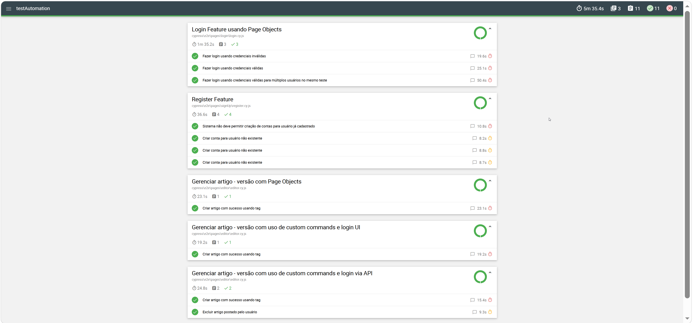

# Automação de testes com Cypress — Conduit (RealWorld)

Suíte de testes end-to-end (E2E) em Cypress para o app **Conduit**, feita para o desafio **"Automação de testes com Cypress"** da [DIO](https://www.dio.me/).

## Objetivo e créditos

- **Desafio:** DIO — Automação de testes com Cypress.
- **Repositório base dos testes:** o projeto da expert **Carolina Louzada**, usado como ponto de partida deste fork.
- **Aplicação testada:** [conduit-realworld-example-app](https://github.com/TonyMckes/conduit-realworld-example-app) de **TonyMckes** (licença MIT), um clone do [RealWorld](https://realworld.io/) em React + Vite no front-end e Express + Sequelize + PostgreSQL no back-end. Este repositório é o fork usado pela DIO.

## Tecnologias

| Tecnologia | Versão |
|---|---|
| Cypress | 12.17.2 |
| cypress-mochawesome-reporter (relatório HTML) | 3.5.1 |
| @faker-js/faker (dados aleatórios) | 8.0.2 |
| Node.js | 18.11+ (o README da raiz pede 18.11+; os testes foram executados com 24.18.0) |
| npm | 11.16.0 (usado nas execuções) |
| PostgreSQL | 17 (17.11 nas execuções) |
| Back-end | Express 4.18.2, Sequelize 6.29.3, pg 8.10.0, bcrypt 5.1.0 |
| Front-end | React 18.2.0, Vite 4.2.1 |
| Testes unitários do app (raiz) | vitest 0.29.7 (não fazem parte desta suíte) |

## Testes cobertos (11)

Os nomes abaixo são os reais, com `describe` e `it`.

**`cypress/e2e/pages/editor/editor.cy.js` — 4 testes**

- *Gerenciar artigo - versão com Page Objects* → Criar artigo com sucesso usando tag
- *Gerenciar artigo - versão com uso de custom commands e login UI* → Criar artigo com sucesso usando tag
- *Gerenciar artigo - versão com uso de custom commands e login via API* → Criar artigo com sucesso usando tag
- *Gerenciar artigo - versão com uso de custom commands e login via API* → Excluir artigo postado pelo usuário

**`cypress/e2e/pages/login/login.cy.js` — 3 testes** (*Login Feature usando Page Objects*)

- Fazer login usando credenciais inválidas
- Fazer login usando credenciais válidas
- Fazer login usando credenciais válidas para múltiplos usuários no mesmo teste

**`cypress/e2e/pages/signUp/register.cy.js` — 4 testes** (*Register Feature*)

- Sistema não deve permitir criação de contas para usuário já cadastrado
- Criar conta para usuário não existente (executado 3 vezes, via `Cypress._.times(3, ...)`)

### Usuários que os testes esperam

Os testes dependem de dois usuários já cadastrados. O script `npm run setup:users` cria ambos:

| Usuário | E-mail | Senha |
|---|---|---|
| `test` | `email@email.com` | `123456` |
| `carol` | `carol@teste.com` | `123456` |

O teste de login inválido usa `carolina.louzada@test.com`, que **não** deve existir.

## Como rodar localmente (passo a passo)

1. **Pré-requisitos:** Node.js 18.11+, npm e PostgreSQL instalados, com o serviço do PostgreSQL rodando.
2. **Instalar as dependências** na raiz do repositório e em `testAutomation` (`npm ci` usa exatamente o que está no `package-lock.json`; `npm install` também serve):

   ```bash
   npm ci
   cd testAutomation
   npm ci
   cd ..
   ```

3. **Criar `backend/.env`** (o arquivo fica **dentro de `backend/`**, não na raiz). Parta de `backend/.env.example`, mas ajuste estes pontos: `DEV_DB_DIALECT=postgres` (o exemplo traz `mysql`), `DEV_DB_USERNAME=postgres` e **não** copie a variável com erro de digitação `DEV_DB_LOGGGIN` (o código lê `DEV_DB_LOGGING`). Se a senha tiver `#`, coloque-a entre aspas duplas, senão o dotenv a corta no `#`:

   ```env
   PORT=3001
   JWT_KEY=<uma-string-secreta-qualquer>
   DEV_DB_USERNAME=postgres
   DEV_DB_PASSWORD="<sua-senha>"
   DEV_DB_NAME=database_development
   DEV_DB_HOSTNAME=127.0.0.1
   DEV_DB_DIALECT=postgres
   ```

   O arquivo `.env` já está no `.gitignore`; nunca o versione.

4. **Criar o banco e aplicar as migrations**, na raiz:

   ```bash
   npm run sqlz -- db:create
   npm run sqlz -- db:migrate
   ```

5. **Subir o app** (back-end na porta 3001 e front-end na 3000), na raiz, e deixar rodando:

   ```bash
   npm run dev
   ```

6. **Rodar os testes** em outro terminal, dentro de `testAutomation`:

   ```bash
   cd testAutomation
   npm run run:e2e:local
   ```

   Esse comando executa `setup:users` (cria os dois usuários, se ainda não existirem) e depois `cypress run` em modo headless com `cypress_dev.config.js` (`baseUrl` `http://localhost:3000/`).

### Outros scripts (em `testAutomation/package.json`)

| Script | O que faz |
|---|---|
| `npm run setup:users` | Cria `email@email.com` e `carol@teste.com` pela API; pode ser repetido sem erro. A URL da API pode ser trocada com a variável `API_URL`. |
| `npm run open:e2e:local` | Abre a interface do Cypress com o config de dev. |
| `npm run run:e2e:local` | `setup:users` + `cypress run` (headless) com o config de dev. |
| `npm run open:e2e:prod` | Abre o Cypress contra o site público. |
| `npm run run:e2e:prod` | Roda headless contra o site público. |

## Notas para Windows

- **`ELECTRON_RUN_AS_NODE`:** terminais abertos dentro do VS Code podem trazer essa variável com valor `1`, o que impede o Cypress de iniciar (erro `bad option: --smoke-test`). Antes de rodar o Cypress, remova-a da sessão (PowerShell):

  ```powershell
  Remove-Item Env:ELECTRON_RUN_AS_NODE -ErrorAction SilentlyContinue
  ```

- **Script `dev` da raiz:** o original usava aspas simples, que o `cmd.exe` não entende, e o `npm run dev` falhava no Windows. Foi corrigido para aspas duplas escapadas.
- **Onde fica o `.env`:** em `backend/.env`. Um `.env` na raiz é ignorado, apesar do que o README original sugere.

## Relatório

A execução gera um relatório HTML do mochawesome em:

```
testAutomation/cypress/reports/html/index.html
```

Abra o arquivo no navegador. Vídeos são gravados em `cypress/videos`, e screenshots de falhas em `cypress/screenshots`. As três pastas estão no `.gitignore`.



## Integração contínua (GitHub Actions)

O workflow [`.github/workflows/e2e.yml`](../.github/workflows/e2e.yml) roda em `push` na `main`, em `pull_request` e manualmente (`workflow_dispatch`). Em um runner `ubuntu-latest` (limite de 30 minutos), ele:

1. sobe um serviço PostgreSQL 17 com health check;
2. instala Node 24 com cache do npm, instala as dependências (`npm ci`) na raiz e em `testAutomation`, e garante o binário do Cypress (com cache de `~/.cache/Cypress`);
3. cria o banco e aplica as migrations;
4. sobe back-end e front-end em segundo plano e espera as duas portas responderem (até 120 s);
5. roda `npm run run:e2e:local`;
6. publica o relatório HTML como artefato (sempre) e, se algo falhar, screenshots, vídeos e logs dos servidores.

> O workflow já foi executado com sucesso no GitHub Actions (aba **Actions** do repositório).

## Melhorias em relação ao original

- **`cypress_dev.config.js` completo:** `baseUrl`, bloco `env` (`emailDefault`, `passwordDefault`, `nameDefault`) e reporter mochawesome, no mesmo formato do config de produção.
- **Script idempotente de criação de usuários** (`setup:users`): 201 conta como criado, 422 como "já existia", e qualquer outro status falha com mensagem clara. Não imprime o token.
- **`run:e2e:local` roda de verdade:** antes ele só abria a interface (`cypress open`); agora executa headless, depois de criar os usuários.
- **Script `dev` da raiz corrigido para Windows.**
- **Execução contra o app local:** na execução contra o site público (fly.dev), 4 dos 11 testes passaram (os do editor) e 7 não passaram (login e signUp). Em 5 desses 7 o erro 429 (Too Many Requests) foi confirmado: o hook do login, que impediu os 3 testes do spec, e ao menos 2 testes do signUp. Nos outros 2 do signUp o 429 é o mais provável, mas a mensagem exata não foi recuperada. Contra o app local, os 11 passaram.
- **Documentação das correções do `.env`:** dialect `postgres`, o erro de digitação `DEV_DB_LOGGGIN`, aspas na senha com `#`, e o local correto do arquivo (`backend/.env`).
- **Workflow no GitHub Actions** com PostgreSQL, descrito acima.

## Pontos de atenção

- **`sync({ alter: true })` completa o esquema:** o back-end roda `sequelize.sync({ alter: true })` ao iniciar. As 4 migrations deixam o esquema incompleto (não criam `Favorites`, `Followers` e `TagList`, e `Comments` fica sem `articleId` e `userId`), então é o `sync` que o completa.
- **Usuários do seed não fazem login:** os seeders gravam as senhas em texto puro (`examplePwd1` etc.), mas o login compara com `bcrypt`. Esses usuários existem no banco, mas não conseguem autenticar. Os testes não usam o seed.
- **Dependências antigas:** o `npm install` e o `npm ci` reportam dezenas de vulnerabilidades (45 na raiz e 23 em `testAutomation` nas instalações feitas). Não foram corrigidas.
- **Nomes de testes preservados do original:** dois testes têm espaço no fim do nome ("Criar artigo com sucesso usando tag " e "Fazer login usando credenciais válidas "), e o teste "Criar conta para usuário não existente" é executado 3 vezes com o mesmo nome. Não foram alterados.
- **Dados acumulados:** cada execução cria usuários e artigos novos no banco `database_development`.

## Cypress Cloud (gravação das execuções)

Desafio DIO "CI/CD com Cypress e GitHub Actions": o pipeline envia o resultado de cada execução (testes, vídeos, screenshots, tempos) para o [Cypress Cloud](https://cloud.cypress.io).

**Como funciona**

- `projectId` nos arquivos `cypress_*.config.js` lê a variável `CYPRESS_PROJECT_ID`.
- O script `npm run run:e2e:cloud` roda o mesmo que `run:e2e:local`, mais `--record` e `--tag ci,github-actions`.
- No workflow, a etapa "Rodar testes E2E" usa `run:e2e:cloud` se `CYPRESS_RECORD_KEY` e `CYPRESS_PROJECT_ID` existirem; senão, usa `run:e2e:local` e o pipeline não quebra.

**Como configurar no seu fork**

1. Crie um projeto no Cypress Cloud e copie o **Project ID** e a **Record Key**.
2. No GitHub: *Settings → Secrets and variables → Actions*.
   - aba **Secrets** → `CYPRESS_RECORD_KEY` = sua Record Key (segredo; nunca versionar);
   - aba **Variables** → `CYPRESS_PROJECT_ID` = seu Project ID (não é segredo).
3. Faça um push ou rode o workflow manualmente (*Run workflow*). A execução aparece no painel do Cypress Cloud.

### Execução em paralelo

O job usa `strategy.matrix` com 2 containers e o comando `npm run run:e2e:cloud -- --parallel --group "E2E paralelo"`. O Cypress Cloud recebe os specs de todas as máquinas e os distribui para que terminem mais rápido (sugestão da própria análise de paralelização do Cloud). Cada máquina sobe seu próprio PostgreSQL e app, e os artefatos têm o número do container no nome. Sem Record Key, o paralelismo não é usado e cada máquina roda a suíte completa sem gravar.

## Reflexões do desafio

**1. Até que ponto devemos aprender sobre configuração de pipelines como QAs?**
O suficiente para não depender de outra pessoa para colocar os testes no fluxo: ler e editar um workflow YAML, entender gatilhos (push, pull request, agendamento), variáveis e segredos, cache, artefatos e como diagnosticar uma falha a partir do log. Montar toda a infraestrutura (runners, deploy, ambientes) costuma ser papel de DevOps, mas o QA precisa saber pedir, revisar e depurar. Aprender a pipeline também ajuda a achar causas fora do teste, como banco fora do ar, porta ocupada ou dependência errada.

**2. Qual recurso do Cypress Cloud achei mais interessante?**
A visão de cada execução com resultado por teste, vídeo e screenshot reunidos, ligada ao commit e ao autor, além das tags e da análise de testes lentos, instáveis e das falhas mais frequentes. Também chama atenção a sugestão de paralelização, que estimou o ganho de tempo por execução. Isso transforma o resultado do CI em dado para decidir o que melhorar na suíte.

**3. Outras ferramentas com integração a pipelines de teste**
- **Playwright:** concorrente direto do Cypress, com paralelismo e sharding nativos, relatórios HTML e traces de depuração, e execução em Chromium, Firefox e WebKit.
- **Selenium (com Selenium Grid):** padrão mais antigo, suporta várias linguagens e navegadores e roda em qualquer CI, mas exige mais configuração.
- **Jenkins, GitLab CI, CircleCI e Azure DevOps Pipelines:** outras plataformas de CI/CD que executam os mesmos testes, cada uma com seu formato de configuração.
- **Allure Report e ReportPortal:** ferramentas de relatório que se integram a vários frameworks e CIs, com histórico e tendências.
- **BrowserStack e Sauce Labs:** executam os testes em nuvem, em muitos navegadores e dispositivos reais.
